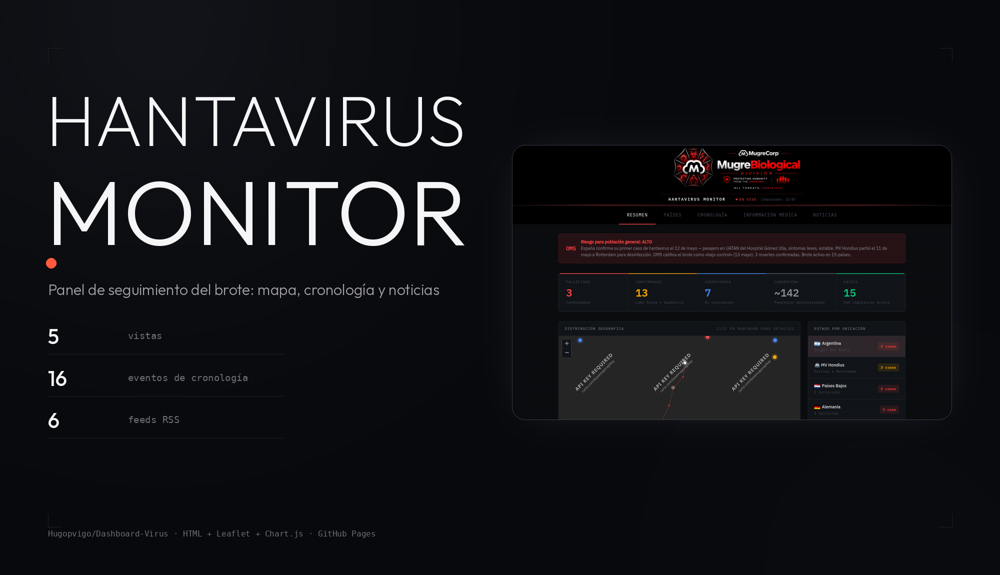
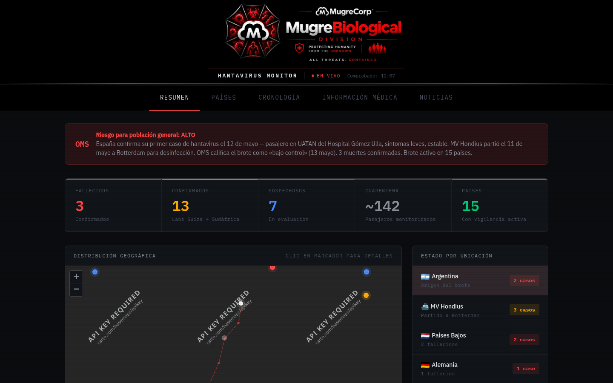
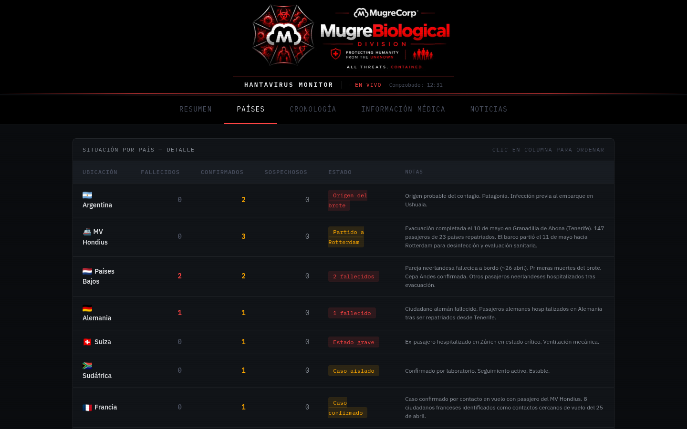

<p align="center">
  
</p>

<p align="center">
  <b>Un panel de seguimiento del brote de hantavirus (cepa Andes) del MV Hondius.</b><br>
  HTML, CSS y JavaScript planos: sin frameworks, sin build, sin npm.
</p>

<p align="center">
  <a href="https://hugopvigo.github.io/Dashboard-Virus/"></a>
  <a href="https://github.com/Hugopvigo/Dashboard-Virus/actions/workflows/deploy.yml"></a>
  
  
</p>

---

## Qué es esto

Un dashboard de inteligencia epidemiológica de **MugreBiological Division**
(MugreCorp) sobre el brote de hantavirus de la **cepa Andes** iniciado a bordo
del crucero de expedición MV Hondius.

Todo el contenido sale de un único fichero: **`data.json`**. El panel es
estático y se publica en GitHub Pages; no hay backend ni base de datos.

| | |
|---|---|
|  |  |
| La vista **Resumen**: banner de alerta, cinco métricas, mapa con la ruta del barco y estado por ubicación. | La vista **Países**: tabla ordenable por cualquier columna, con notas por país. |
|  | |
| La vista **Cronología**: 16 hitos del brote, del zarpe del 20 de marzo a la evacuación del 10 de mayo. | |

## Qué muestra

**5 vistas**, todas en el mismo `index.html`:

1. **Resumen** — banner de riesgo (OMS), métricas, mapa Leaflet con la ruta
   del barco y estado por ubicación.
2. **Países** — tabla de 15 ubicaciones (14 países y el propio barco) con
   fallecidos, confirmados, sospechosos, estado y notas; se ordena pulsando en
   la cabecera.
3. **Cronología** — los 16 hitos del brote, con el punto de color según la
   gravedad.
4. **Información médica** — síntomas por fase, vías de transmisión de la cepa
   Andes y protocolo de actuación ciudadana.
5. **Noticias** — agregado de **6 feeds RSS** (El País, 20min, ABC Ciencia, La
   Vanguardia, BBC Health y El Mundo) con filtro por fuente.

El mapa usa tiles oscuros de CartoDB y la gráfica de evolución, Chart.js 4.

## Actualizar los datos

Todos los números viven en `data.json`. Para cambiarlos:

```bash
git clone https://github.com/Hugopvigo/Dashboard-Virus.git
cd Dashboard-Virus
$EDITOR data.json
git commit -am "data: cifras del brote"
git push
```

La estructura de `data.json`:

```jsonc
{
  "meta":      { "lastUpdate": "…", "alertLevel": "ALTO", "alertText": "…" },
  "totals":    { "deaths": 3, "confirmed": 13, "suspected": 7,
                 "quarantine": 147, "countries": 15 },
  "facts":     [ { "label": "…", "value": "…", "color": "red" } ],
  "countries": [ { "name": "…", "lat": 0, "lng": 0,
                   "deaths": 0, "confirmed": 0, "suspected": 0,
                   "status": "high", "statusText": "…", "notes": "…" } ],
  "shipRoute": [ { "lat": 0, "lng": 0, "label": "…" } ],
  "timeline":  [ { "date": "20 Mar", "dot": "gray", "text": "…" } ],
  "newsSources": [ { "name": "El País", "color": "#4488ff", "url": "…" } ],
  "trend":     { "labels": [ … ], "confirmed": [ … ], "deaths": [ … ] }
}
```

Hay además **`admin.html`**: una pantalla que carga `data.json` desde la API de
GitHub, deja editar las cifras, el banner, los países, la cronología y la
gráfica, y los vuelve a subir con un `PUT` a la Contents API. Pide un token
personal de GitHub, que se guarda solo en el `localStorage` del navegador (no
va al repo). El repo en GitHub se llama `Dashboard-Virus`; la página admin
conserva el nombre antiguo `dashboard_virus`, que GitHub redirige
automáticamente.

## Verlo en local

```bash
git clone https://github.com/Hugopvigo/Dashboard-Virus.git
cd Dashboard-Virus
python3 -m http.server 8000
# → http://localhost:8000
```

Hace falta servidor (no vale abrir `index.html` con `file://`, porque el panel
pide `data.json` por `fetch`).

El despliegue a GitHub Pages es automático: cada `push` a `main` dispara
`.github/workflows/deploy.yml`.

## Estructura

```
Dashboard-Virus/
├── index.html               shell principal (5 vistas)
├── admin.html               editor de data.json vía API de GitHub
├── hantavirus-dashboard.html  versión autónoma, con los datos incrustados
├── data.json                fuente única de datos
├── css/style.css
├── js/
│   ├── map.js               Leaflet + ruta del barco + marcadores
│   ├── charts.js            gráfica de evolución (Chart.js)
│   ├── news.js              agregado de RSS con filtros
│   └── main.js              arranque, navegación, contadores y tablas
├── logo.webp               marca MugreBiological
└── docs/capturas/
```

## Licencia

El código y los datos están bajo **CC BY-NC-SA 4.0** (compartir con
atribución, sin uso comercial y en las mismas condiciones). Ver
[LICENSE](LICENSE).

Las fuentes citadas (OMS, ECDC, Ministerio de Sanidad) enlazan a sus páginas
originales.
